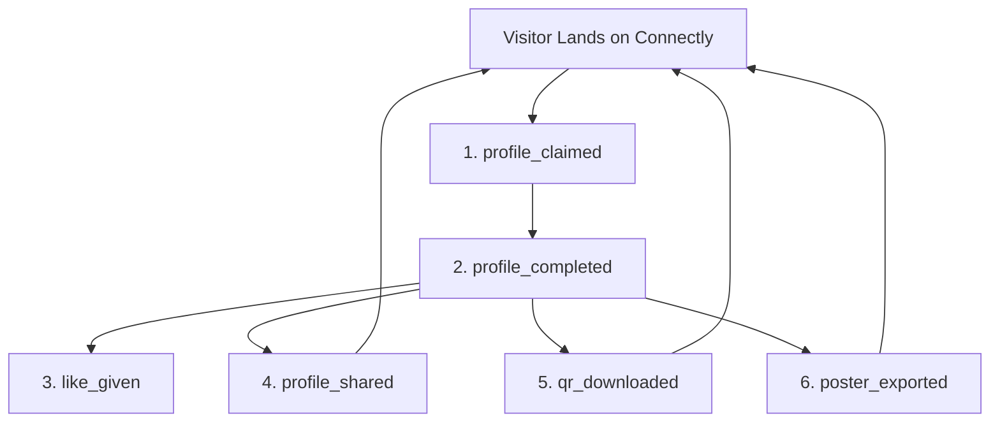
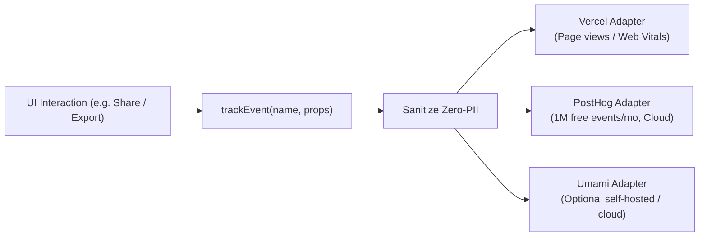

# Connectly Growth Funnel & Analytics Architecture

This document specifies the product analytics taxonomy, funnel metrics, and strict zero-PII data privacy guarantees implemented for Connectly using `@vercel/analytics`.

---

## 1. Funnel Architecture Overview

Connectly's conversion and viral loops are tracked through a 6-stage lifecycle funnel:



### Conversion Milestones & Target Ratios

| Funnel Stage | Event Name | Trigger Condition | Conversion Goal |
| :--- | :--- | :--- | :--- |
| **Stage 1: Acquisition** | `profile_claimed` | User authenticates via Google/Auth and registers their unique handle. | Top-of-Funnel Entry |
| **Stage 2: Activation** | `profile_completed` | User adds >= 1 social link, bio description, and profile avatar. | > 65% of claimed profiles |
| **Stage 3: Engagement** | `like_given` | Profile visitor taps the heart button to give verified social proof. | > 2.5 likes per active profile |
| **Stage 4: Virality (Digital)** | `profile_shared` | User copies profile link or shares to WhatsApp, Twitter, LinkedIn, Telegram. | > 40% of creators share profile |
| **Stage 5: Utility (QR)** | `qr_downloaded` | User downloads a high-contrast branded QR code badge for badges or phones. | > 30% of active profiles |
| **Stage 6: Offline Wedge** | `poster_exported` | User prints or saves an A4 desk poster, conference badge, or sticker sheet. | > 15% of active creators |

---

## 2. Event Taxonomy & Payload Schema

All events are strictly typed in `src/utils/analytics.ts` and dispatch to `@vercel/analytics`:

### `profile_claimed`
- **When**: Triggered upon successful account registration and username reservation.
- **Properties**:
  - `method`: `'google' | 'email' | 'anonymous' | 'direct'`
  - `theme_id`: Theme identifier chosen at creation (e.g. `'aurora-glass'`, `'cyberpunk'`, `'glass'`).

### `profile_completed`
- **When**: Triggered when a creator updates links, bio, or avatar.
- **Properties**:
  - `links_count` *(number)*: Total active social/portfolio links.
  - `has_avatar` *(boolean)*: Whether an avatar is configured.
  - `has_bio` *(boolean)*: Whether a biography/tagline is present.
  - `has_tagline` *(boolean)*: Whether a subtitle/headline is set.
  - `theme_id` *(string)*: Active styling theme.

### `profile_shared`
- **When**: Triggered when a creator or visitor initiates a profile share.
- **Properties**:
  - `platform`: `'whatsapp' | 'twitter' | 'linkedin' | 'telegram' | 'clipboard' | 'native_share'`
  - `source`: `'public_profile' | 'dashboard' | 'qr_modal' | 'command_palette'`

### `qr_downloaded`
- **When**: Triggered when a user downloads their high-contrast QR badge.
- **Properties**:
  - `format`: `'png' | 'svg' | 'jpeg'`
  - `theme`: Theme styling applied to the QR frame.
  - `has_logo`: *(boolean)* Whether a central avatar emblem is embedded.

### `poster_exported`
- **When**: Triggered when an event poster, desk placard, or hackathon badge is printed or exported.
- **Properties**:
  - `layout`: `'portrait' | 'landscape' | 'square' | 'story'`
  - `format`: `'png' | 'pdf' | 'jpeg'`
  - `theme`: Branded colorway.

### `like_given`
- **When**: Triggered when a visitor gives kudos / a like to a public profile.
- **Properties**:
  - `is_guest` *(boolean)*: Whether the liker is an unauthenticated visitor.
  - `theme_id` *(string)*: Theme of the profile being liked.

---

## 3. Provider-Agnostic Analytics Architecture

Vercel Analytics on the Hobby (free) plan tracks page views and Web Vitals, but custom events require a paid Pro subscription ($20/mo). To ensure Connectly founders have enterprise-grade funnel visibility without unexpected cloud bills, Connectly utilizes a **provider-agnostic analytics architecture**:



### Free-Tier Tool Recommendation: PostHog Cloud

| Criterion | PostHog Cloud (Recommended) | Umami Cloud |
| :--- | :--- | :--- |
| **Free Tier Volume** | **1,000,000 events / month** | 10,000 events / month |
| **Hosting Overhead** | **Zero** (Managed Cloud, US & EU data centers) | Managed or Self-Hosted (requires Postgres + server) |
| **Funnel Analysis** | **Built-in multi-step funnel visualization** | Basic event counting |
| **Setup Friction** | **Paste 1 API key into Vercel** | Script tag or self-hosting deployment |
| **Cost** | **$0 forever** under 1M events | $0 (10k) then $9/mo |

**Recommendation Rationale**: PostHog Cloud offers 100x the event volume of Umami Cloud for free, requires zero server maintenance, and provides drag-and-drop funnel dropoff graphs directly matching Connectly's 6 lifecycle stages.

### Environment Configuration (Names Only)

Add to `.env` or Vercel Environment Variables:
```bash
# PostHog (Recommended)
VITE_POSTHOG_API_KEY="phc_your_key_here"
VITE_POSTHOG_HOST="https://us.i.posthog.com" # optional, defaults to US cloud

# Umami (Alternative)
VITE_UMAMI_WEBSITE_ID="your_umami_website_id"
VITE_UMAMI_HOST="https://cloud.umami.is"
```

*Note: If no external keys are provided, `track()` operates safely as a clean no-op in production and logs to the browser developer console in development.*

---

## 4. Strict Zero-PII Compliance Guarantee

Connectly strictly adheres to GDPR, CCPA, and privacy-first engineering:
1. **No Identifiable PII**: User email addresses, real legal names, phone numbers, and physical addresses are NEVER included in analytics event payloads.
2. **No Raw Handles**: Usernames and private URLs are excluded from custom event metadata to prevent re-identification across analytics exports.
3. **Anonymous Distinct IDs**: When PostHog is active, an anonymous random UUID (`connectly_anon_id`) is stored in `localStorage` to connect funnel stages without linking to personal identity.
4. **Cookie-less Page Views**: Vercel Analytics operates without third-party tracking cookies or cross-site fingerprinting.
5. **Development Sandboxing**: In local development (`import.meta.env.DEV`), events are logged to the browser console for inspection without polluting production telemetry.

