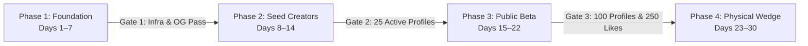

# Connectly Gated 30-Day Growth & Launch Plan

This plan establishes a 4-phase, strictly gated rollout for Connectly: "One Profile. Every Connection."
Each phase cannot unlock until its singular gate metric is verified. All unconfirmed assumptions and founder inputs remain explicitly marked with `[NEEDS FACT]`.

---

## 1. Gated Rollout Architecture

### Gate Definitions & Unlocking Conditions

| Phase | Duration | Core Focus | Singular Gate Metric | Status |
| :--- | :--- | :--- | :--- | :--- |
| **Phase 1: Foundation** | Days 1–7 | Routing, OG Bot Cards, Analytics, Scheduler | **100% Core Passes**: Path routing, Edge OG (200 & generic fallback), zero PII analytics, and daily job execution. | **IN PROGRESS** |
| **Phase 2: Seed Creators** | Days 8–14 | 1-on-1 Onboarding, Design Polish, Friction Logs | **`[NEEDS FACT: Gate 2 threshold]`**: Seed profiles claimed and completed by target cohort. | Locked |
| **Phase 3: Public Beta** | Days 15–22 | Twitter/LinkedIn/WhatsApp launch, Viral like loops | **`[NEEDS FACT: Gate 3 threshold]`**: Total claimed profiles and verified likes given. | Locked |
| **Phase 4: Wedge Pilot** | Days 23–30 | In-person hackathon / campus poster test | **`[NEEDS FACT: Gate 4 threshold]`**: Physical posters exported and offline QR scans. | Locked |

---

## 2. Week-1 Launch Checklist (Operational Foundation)

Execute these operational steps in exact sequence:

- [ ] **Buy custom domain (manual)**: Founder to acquire chosen domain (e.g., `connectly.bio`, `connectly.me`, or `.app`).
- [ ] **Connect domain in Vercel**: Add domain in Vercel Dashboard -> Project Settings -> Domains. Set up DNS records (CNAME or A records).
- [ ] **Set `VITE_SITE_URL` and `SITE_URL`**:
  - `VITE_SITE_URL` added to **Production** & **Preview** in Vercel (`https://yourcustomdomain.com`).
  - `SITE_URL` added to **Production** & **Preview** in Vercel (`https://yourcustomdomain.com`).
- [ ] **Configure 301 Redirect from `vercel.app`**: In `vercel.json` or Vercel dashboard redirect rule, configure 301 permanent redirect from `connectly-hazel.vercel.app` to canonical domain.
- [ ] **Preview Bot Verification Tests**: Run `curl -A "WhatsApp/2.0"` and `curl -A "Twitterbot/1.0"` against preview and production URLs to verify HTTP 200 and `<meta property="og:...">` edge tags render for claimed handles and generic fallback works.
- [ ] **Merge PRs (in order)**:
  1. Merge **PR #1** (`feature/path-routing-and-edge-og`) to `main`.
  2. Merge **PR #2** (`feature/analytics-and-funnel-tracking`) to `main`.
- [ ] **Confirm Funnel Events Arrive**: Visit staging/production, claim a profile, export a poster, and verify `profile_claimed`, `profile_completed`, and `poster_exported` events populate in PostHog or Umami dashboard with zero PII.

---

## 3. Phase-by-Phase Execution Schedule

### Phase 1: Foundation & Core Integrity (Days 1–7)
- **Day 1**: PR #1 path-based routing, edge OpenGraph cards, legacy hash redirects (`#/@handle` -> `/@handle`).
- **Day 2**: PR #2 Analytics integration, provider-agnostic adapter (PostHog/Umami), zero-PII custom events.
- **Day 3**: Preview deployment verification with social crawlers (`WhatsApp`, `Twitterbot`, `LinkedInBot`, `facebookexternalhit`).
- **Day 4**: Domain decision (`[NEEDS FACT: custom domain decision]`) and DNS cutover.
- **Day 5**: Automated daily content queue verification via Hermes scheduler (`connectly-daily-drafts`).
- **Day 6**: Mobile viewport and print CSS styling stress test (A4, Badge, Minimal formats).
- **Day 7**: **Gate 1 Audit Review**. Proceed to Phase 2 only if Gate 1 is 100% green.

### Phase 2: Seed Cohort & Feedback Loop (Days 8–14)
- **Target Audience**: `[NEEDS FACT: First target audience segment]`.
- **Day 8–10**: Direct personal outreach to seed creators (`[NEEDS FACT: outreach channel/handles]`).
- **Day 11**: Collect friction logs on profile creation, link ordering, and QR badge clarity.
- **Day 12**: Rapid iteration on top UX blockers identified by seed users.
- **Day 13**: Seed users test "Save vCard" contact sharing in real mobile browsers.
- **Day 14**: **Gate 2 Audit Review**. Require completed seed profiles to unlock Public Beta (`[NEEDS FACT: Gate 2 number]`).

### Phase 3: Public Launch & Distribution (Days 15–22)
- **Platforms**: `[NEEDS FACT: Twitter/X handle, LinkedIn page, Product Hunt, Reddit]`.
- **Day 15**: Public launch announcement: "Why we built Connectly — link-in-bio meets printable badges."
- **Day 16**: Shareable graphic showcases: Highlight standout seed creator profiles.
- **Day 17**: Community demo video: 30-second workflow from claim to printed desk poster.
- **Day 18**: Viral like challenge: "Send kudos to your favorite hackathon teammate."
- **Day 19**: Product Hunt / Show HN submission (`[NEEDS FACT: target submission date & hunter]`).
- **Day 20–21**: Monitor live funnel metrics; optimize drop-offs between `profile_claimed` and `profile_completed`.
- **Day 22**: **Gate 3 Audit Review**. Unlock Physical Wedge Pilot upon hitting verified target (`[NEEDS FACT: Gate 3 number]`).

### Phase 4: Physical Wedge Pilot (Days 23–30)
- **Wedge Focus**: In-person tech events, hackathons, college demo days, or coworking desk placards.
- **Venue / Event**: `[NEEDS FACT: Name and date of upcoming local meetup or hackathon]`.
- **Day 23–24**: Print batch of sample Connectly table tent cards and badge attachments for participants.
- **Day 25–26**: Live deployment at venue: Participants scan table QR codes to view speaker & builder profiles.
- **Day 27**: Measure scan-to-claim conversion rate (scans arriving at profile vs new profiles claimed).
- **Day 28**: Creator interview: Qualitative feedback from attendees who used the printable badge.
- **Day 29**: Compile full 30-day growth retrospective report (`weekly-growth-report` skill).
- **Day 30**: **Gate 4 Audit Review & Month 2 Expansion Roadmap**.

---

## 4. Pending Founder Inputs (`[NEEDS FACT]`)

The following parameters will be plugged in once confirmed:
1. `[NEEDS FACT: Real user count today]` (Assumed 0–5 during testing).
2. `[NEEDS FACT: 30-day primary North Star metric]` (e.g. verified active profiles).
3. `[NEEDS FACT: First target audience segment]` (e.g. collegiate hackathon builders, tech creators).
4. `[NEEDS FACT: Connected social scheduling accounts]` (e.g. Buffer, Typefully, or manual review).
5. `[NEEDS FACT: Custom domain acquisition status]` (e.g. `connectly.bio`, `connectly.me`, or Vercel preview).

